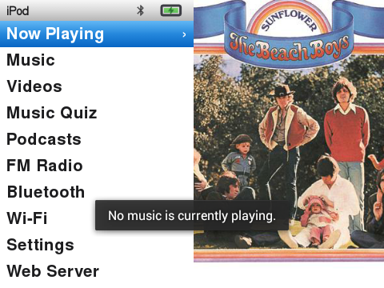
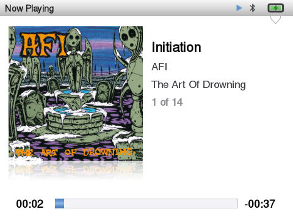
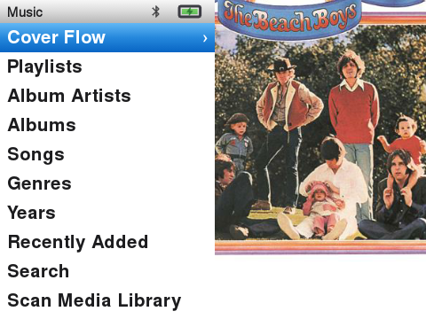
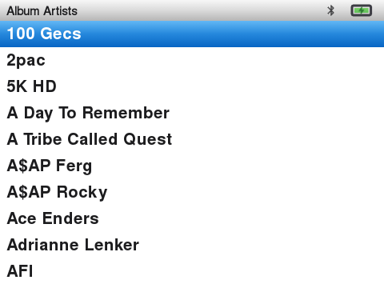
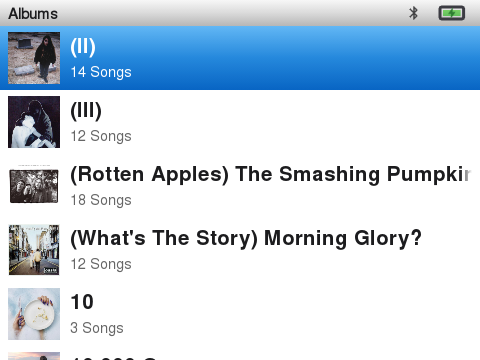
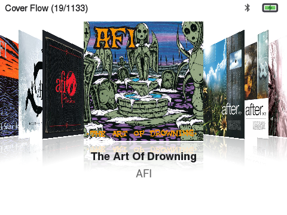

# InniClassic

<p align="center">
  
  
  
</p>

InniClassic is an iPod Classic-style launcher and media player for Innioasis Y1 and Y2 portable audio players, based on [FabianZettl/inniclassic](https://github.com/FabianZettl/inniclassic) and [ismileblue/y1_launcher](https://github.com/ismileblue/y1_launcher). It recreates the classic click wheel interface while adding features like hardware FM radio, podcasts, video playback, and a library-based Music Quiz.

---

## Screenshots

| Main Menu | Now Playing | Music |
|---|---|---|
|  |  |  |

| Artists | Album View | Cover Flow |
|---|---|---|
|  |  |  |

---

## Features

### The iPod Classic experience
- Bundled iPod Classic theme in light and dark variants: plain text menu lists, system-matched typography, authentic spacing, and a status bar showing the active screen name rather than a clock.
- Two-pane Main Menu and Music menu sharing the same layout: menu list on the left and a slowly panning album cover on the right extending behind the status bar.
- Redesigned Now Playing screen with a large angled album cover, an optional mirror reflection below it (controlled by Album Cover Tilt), a glass progress and volume bar, and marquee scrolling for longer titles.
- Center button on Now Playing cycles between Progress, Seek, Shuffle & Repeat, and Rating. When cycling, the click wheel previews seek positions in 5-second steps, toggles shuffle and repeat modes, or sets star ratings, defaulting to volume control otherwise.
- In Seek mode, spinning the wheel selects a time offset; pressing Center applies the seek and returns to Progress. Pressing Center without turning advances to the next mode.
- On-The-Go playlist creation and a Now Playing hold menu (long-press Play/Pause) for adding favorites, queueing to On-The-Go, browsing by album or artist, and switching visualizers.
- Synced lyrics support replacing the spectrum visualizer when lyrics exist for the current track, reading either adjacent `.lrc` files or embedded tags (`USLT` in MP3, or FLAC and ALAC lyrics tags). Timestamps in `[mm:ss.xx]` format scroll smoothly in time with the song.
- Favorites system with a heart icon on the Now Playing screen, highlighted red when favorited.
- Fast-scroll letter jumping on alphabetized lists matching original click wheel navigation.
- Rebuilt iPod Music Quiz in endless survival mode using tracks from your local library, featuring six questions per round, non-linear timer scaling, persistent top-10 leaderboards, and a between-rounds heart shop.

### Music library
- Library browsing by Artists, Album Artists, Albums, Songs, Genres, Composers, Playlists, and Favorites. The Artists view splits by individual track artist tags so guest features appear distinctly, while Album Artists groups releases by main artist.
- Recently played albums shelf tracking playback history with direct full-album navigation.
- Audio format support covering MP3, FLAC, WAV, OGG Vorbis, Opus (including Opus audio inside `.ogg` containers), ALAC/M4A, and AAC.
- Gapless playback for albums and playlists containing 15 tracks or fewer (see [Known limitations](#known-limitations)).
- Shuffle shortcut pinned to the top of the All Songs list, matching original Y1 firmware behavior.
- High-resolution cover art support. Using square images of at least 600x600 pixels (preferably 1000x1000 or larger) avoids blur during the panning animation across the menu split screen. Both embedded tags (ID3, FLAC, ALAC) and directory images (`cover.jpg` or `folder.jpg`) are detected automatically.
- Built-in Last.fm scrobbling. Tracks played past the midpoint or four minutes are logged to `.scrobbler.log` on the SD card root in Audioscrobbler 1.1 format. To upload scrobbles directly to Last.fm, enable Settings > Sync Scrobbles to Last.fm and authenticate via Settings > Last.fm Account. The device displays a QR code and URL to open on a phone or computer, queuing scrobbles locally until a network connection is available.

### Beyond music
- Jellyfin music synchronization client with QuickConnect pairing, remote library browsing, offline track caching, and automatic library scanning.
- Podcast manager supporting feed subscriptions, direct streaming, and episode downloads for offline listening.
- Built-in FM radio communicating directly with the internal tuner chip.
- Video player with dedicated library browsing from the Videos folder on storage. Playback uses libVLC for frame synchronization, provides click wheel volume control, seeks in 10-second jumps using Previous and Next buttons, generates video thumbnails, and remembers playback positions. The Fill Video Screen setting toggles between letterboxing and filling the display.
- Audiobook player with automatic bookmarking and resumed playback.
- Wireless music transfer through an embedded local web server accessible over Wi-Fi.

### Innioasis Y2 support
- Dual storage library scanning that indexes music, audiobooks, and videos across internal storage (`/storage/sdcard0`) and external microSD cards (`/storage/sdcard1`).
- MicroSD watchdog monitor that detects unmounted or degraded FAT and exFAT partitions, applies filesystem repairs, remounts `fuse_sdcard1`, and triggers a library refresh once ready.
- Hardware FM radio integration on Android 4.4.2 that clears Airplane Mode tuner lockouts (`ensureAirplaneModeOff()`), synchronizes MediaTek audio streams, and uses a wake lock to keep radio audio playing when the screen sleeps.
- Hardware click wheel key mapping (`scripts/Y2.kl`) linking hardware scancodes 103 and 108 to `DPAD_LEFT` and `DPAD_RIGHT`.
- Lower headphone output curve that recalibrates MediaTek hardware headset gain tables, cutting minimum output (step 1) by roughly 18 dB for sensitive IEMs and low-impedance headphones.
- ROM builder script (`scripts/build-rom.sh`) to assemble update images for Y1 (hardware revisions Type A and Type B) and Y2 devices.

## Known limitations

- Gapless playback works on queues of 15 tracks or fewer, with shuffle disabled and without FLAC tracks. FLAC uses a standalone decoding pipeline separate from ExoPlayer, while large or shuffled queues retain track-by-track loading.
- Video playback runs on libVLC because ExoPlayer lacks frame-timing mechanisms on Android versions prior to 5.0 (API 21). For dependable playback, encode source videos around 640x480 resolution, 30 fps, and bitrates near 2 Mbps or lower (see [`tools/handbrake_y1_preset.json`](tools/handbrake_y1_preset.json) for a HandBrake profile).

## Installation

Two installation methods are available depending on whether you want a full ROM install or an APK update.

### Method 1: Innioasis Updater (recommended)

Prebuilt firmware packages with InniClassic preinstalled as the default system launcher are available on [Releases](https://github.com/JonaszPotoniec/inniclassic-y2/releases):
- Innioasis Y2: `rom_y2.zip` (Android 4.4.2 KitKat)
- Innioasis Y1: `rom_y1_type_a.zip` or `rom_y1_type_b.zip` depending on hardware revision

To flash via the updater:
1. Download the archive matching your device from [Releases](https://github.com/JonaszPotoniec/inniclassic-y2/releases) and ensure it is named `rom.zip` (required by the updater tool).
2. Open the [Innioasis Updater](https://www.innioasis.com/pages/download), choose `rom.zip` as the local firmware package, and follow the on-screen steps.
3. Once the flashing process completes and the player restarts, InniClassic starts automatically.

> [!WARNING]
> Keep the device connected and powered until the update finishes. Do not unplug the cable during the flash.

### Method 2: Standalone APK update

Use this method to update the app on an existing device without reflashing the full system partition.

1. Uninstall the existing launcher package first:
   ```bash
   adb uninstall com.themoon.y1
   ```
   If pre-installed as a system application, uninstall it for the current user:
   ```bash
   adb shell pm uninstall --user 0 com.themoon.y1
   ```
   > [!NOTE]
   > Uninstalling is required due to differing APK signature keys between builds. Your music library, custom themes in `/storage/sdcard0/Y1_Themes`, and `.scrobbler.log` on storage remain untouched.
2. Download `InniClassic-<version>.apk` from [Releases](https://github.com/JonaszPotoniec/inniclassic-y2/releases).
3. Install the APK via ADB:
   ```bash
   adb install InniClassic-<version>.apk
   ```
4. Optional step if Bluetooth pairing prompts for elevated permissions unavailable through the interface:
   ```bash
   adb shell pm grant com.themoon.y1 android.permission.WRITE_SECURE_SETTINGS
   ```

## Pre-building the library cache

InniClassic caches scanned track metadata to `.y1_library_cache.json` at the root of the SD card. Files already indexed in this file skip tag extraction during subsequent scans.

For large music libraries with thousands of songs, you can generate this cache on a computer using [`tools/build_library_cache.py`](tools/build_library_cache.py). Running tag extraction on desktop hardware takes seconds, leaving the portable player to perform only a fast file existence check when the card is inserted.

The script requires Python with the `mutagen` package installed (`pip install mutagen`) and direct filesystem access to the microSD card through a card reader or USB mass storage mode (MTP is not supported):

```bash
python3 tools/build_library_cache.py /path/to/sdcard
```

Run the script after transferring music to the card and before mounting it back into the player.

## Building from source

Last.fm API credentials are not included in this repository. To compile with scrobbling support:

1. Register an API application at [last.fm/api/account/create](https://www.last.fm/api/account/create).
2. Add your credentials to `local.properties`:
   ```properties
   lastfm.api.key=YOUR_KEY
   lastfm.api.secret=YOUR_SECRET
   ```
3. Compile with `./gradlew assembleDebug`. If you omit the keys, the build succeeds and all features work except Last.fm submission.

## Credits and license

- Original InniClassic project by Fabian Zettl: [FabianZettl/inniclassic](https://github.com/FabianZettl/inniclassic).
- Derived from [ismileblue/y1_launcher](https://github.com/ismileblue/y1_launcher) (JJ Launcher / MO-ON Launcher) by ismileblue.
- The iPod Classic interface uses [Nimbus Sans](https://en.wikipedia.org/wiki/Nimbus_Sans) (URW++), a metric-compatible alternative to Helvetica.
- Distributed under upstream's license terms; see [LICENSE](LICENSE) for personal and educational use guidelines.

Version history is documented on [GitHub Releases](https://github.com/JonaszPotoniec/inniclassic-y2/releases).
